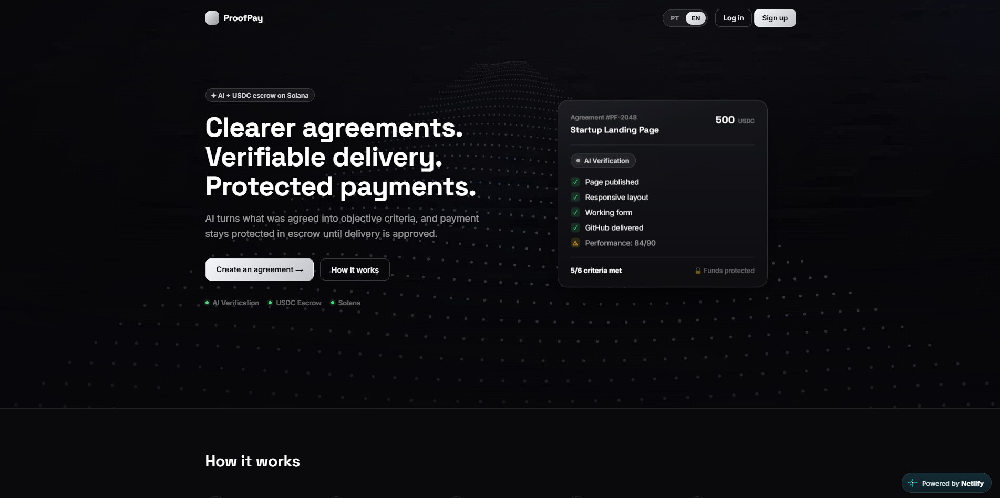
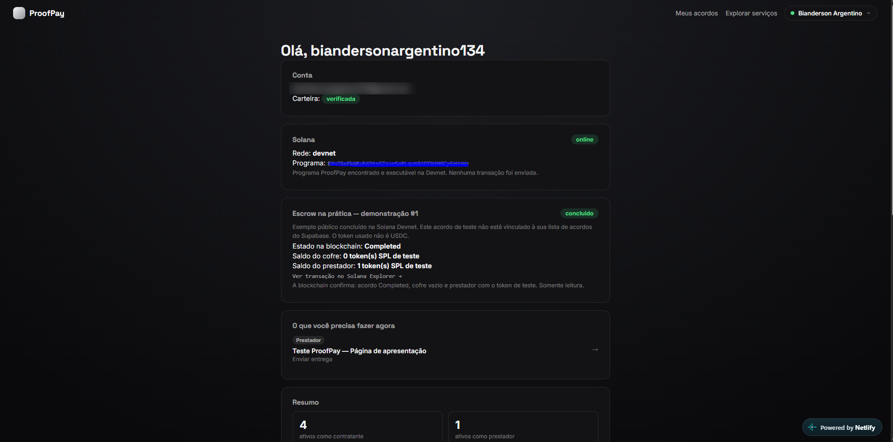
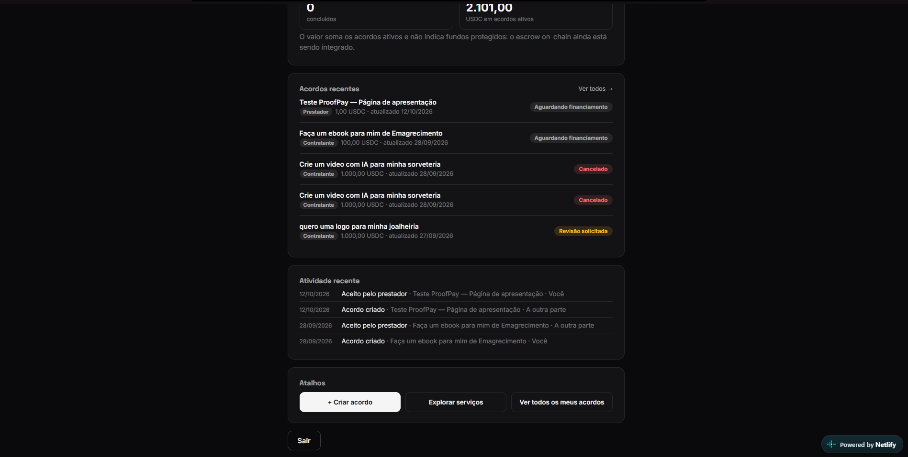

# ProofPay

**Contratos mais claros. Entregas verificáveis. Pagamentos protegidos.**

Marketplace de serviços em que a IA transforma o que foi combinado em critérios objetivos e o pagamento fica protegido em escrow na blockchain até a entrega ser aprovada.

**Site:** https://proofpayteam.netlify.app

> **Estado atual:** MVP funcional rodando na **Solana Devnet** com **tokens SPL de teste**. Nenhum valor real é movimentado. A troca dos tokens de teste por USDC ou pela moeda da Solana está planejada.



## Como funciona

1. **Descreva:** o contratante descreve o serviço em linguagem natural.
2. **A IA estrutura:** a descrição vira uma lista de critérios objetivos.
3. **Proteja o pagamento:** o valor fica reservado no escrow.
4. **Envie a entrega:** o prestador apresenta as evidências.
5. **Verifique e aprove:** a IA analisa as evidências e o contratante tem a decisão final.

Exemplo: em um acordo de "Landing Page para Startup", a IA confere se a página foi publicada, se é responsiva, se o formulário funciona, se o repositório foi entregue e se a performance atinge o mínimo combinado, e mostra quantos critérios foram atendidos.

## O que já está funcionando

- Landing page bilíngue (português e inglês)
- Cadastro, login e verificação de carteira
- Criação de acordos, com aceite pelo prestador
- Geração de critérios e verificação da entrega por IA (a decisão final é sempre do contratante)
- Envio da entrega pelo prestador
- Programa de escrow na Solana Devnet com transferência de tokens SPL de teste, com transação verificável no Solana Explorer
- Dashboard com resumo, acordos recentes, atividade e atalhos

## Telas

### Dashboard e escrow na Devnet



### Acordos e atividade



## Tecnologias

| Camada | Tecnologias |
| --- | --- |
| Front-end | HTML, CSS, JavaScript, React, Vite |
| Banco de dados e autenticação | Supabase |
| Inteligência artificial | Modelos de linguagem (Claude e ChatGPT) |
| Blockchain | Solana (Devnet), tokens SPL |
| Hospedagem | Netlify |

## Estrutura do repositório

```
proofpay-site/
├── web/        # aplicação web (landing page e dashboard)
└── supabase/   # banco de dados e configuração do Supabase
```

## Como rodar localmente

Pré-requisitos: Node.js 18 ou mais recente e um projeto no Supabase.

```bash
git clone https://github.com/biandersonargentino134-maker/proofpay-site.git
cd proofpay-site/web
npm install
npm run dev
```

Crie um arquivo `.env` dentro de `web/` com a URL e a chave pública (anon) do seu projeto Supabase. Nunca envie esse arquivo para o GitHub nem use a chave `service_role` no front-end.

## Roadmap

- [x] Landing page bilíngue (PT/EN)
- [x] Autenticação e carteira verificada
- [x] Verificação de entregas por IA
- [x] Entrega do acordo pelo prestador
- [x] Escrow com tokens SPL de teste na Solana Devnet
- [ ] Integrar o escrow on-chain a todos os acordos criados no app
- [ ] Trocar os tokens de teste por USDC ou pela moeda da Solana
- [ ] Migrar da Devnet para a Mainnet

## Equipe

- **Bianderson Argentino:** front-end, UX, dashboard e integração com Supabase e IA ([GitHub](https://github.com/biandersonargentino134-maker) · [LinkedIn](https://www.linkedin.com/in/bianderson-argentino-a61133424/))
- **Marcos:** programa on-chain (escrow) na Solana